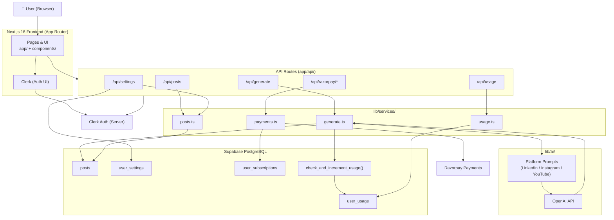

# 🏗️ WorktoWords — Architecture

This document gives new contributors a quick mental model of how WorktoWords is structured — how the frontend, backend, AI, auth, database, and payments fit together.

---

## System Flow



---

## Layer Breakdown

### 🖥️ Frontend — `app/` + `components/`
Next.js 16 App Router handles all pages and UI. Key pages include the dashboard, history, and settings. UI components live in `components/` and are built with **Tailwind CSS** and **shadcn/ui**.

### 🔐 Auth — Clerk
Clerk handles sign-in (Google supported). The `proxy.ts` file wraps Clerk middleware to protect routes like `/dashboard`, `/history`, and `/settings`. Server-side routes validate the Clerk session before any DB access.

### 🧠 AI Generation — `lib/ai/` + OpenAI
Platform-specific prompts for LinkedIn, Instagram, and YouTube live in `lib/ai/`. The `lib/services/generate.ts` service picks the right prompt, calls the OpenAI API, and returns the generated content. Two modes are supported: **Help Me Write** and **Write For Me**.

### 🗄️ Database — Supabase PostgreSQL
All user data is stored in Supabase. The schema is defined in `supabase/posts.sql`. The key function `check_and_increment_usage()` atomically checks daily limits and handles Pro plan expiry downgrade in a single DB call.

| Table | What it stores |
|---|---|
| `posts` | Generated content per platform |
| `user_settings` | Default goal and tone |
| `user_usage` | Daily usage count, plan type, expiry |
| `user_subscriptions` | Razorpay order and payment refs |

### 💳 Payments — Razorpay
Pro upgrades (₹149 / 30 days) use Razorpay Standard Checkout. The server creates an order, the client opens the checkout, and on success the server verifies the signature and upgrades the user's plan in Supabase.

### 🔌 API Routes — `app/api/`
All business logic is kept in `lib/services/` and called from thin API route handlers. This keeps routes clean and logic testable.

---

## Key Files for New Contributors

```text
proxy.ts                          # Clerk auth middleware + security headers
app/                              # All pages and API routes
components/                       # All UI components
lib/
  ai/                             # Platform-specific AI prompts
  services/
    generate.ts                   # Core generation logic
    payments.ts                   # Razorpay order + verify
    usage.ts                      # Daily limit checks
    posts.ts                      # Post CRUD
supabase/
  posts.sql                       # Full DB schema (run this first!)
```

---

## Quick Start Reminder

1. Run `supabase/posts.sql` in your Supabase SQL editor before anything else.
2. Fill in `.env.local` with Clerk, OpenAI, Supabase, and Razorpay keys.
3. Run `pnpm dev` and open [http://localhost:3000](http://localhost:3000).

For full setup instructions, see [README.md](../README.md).
